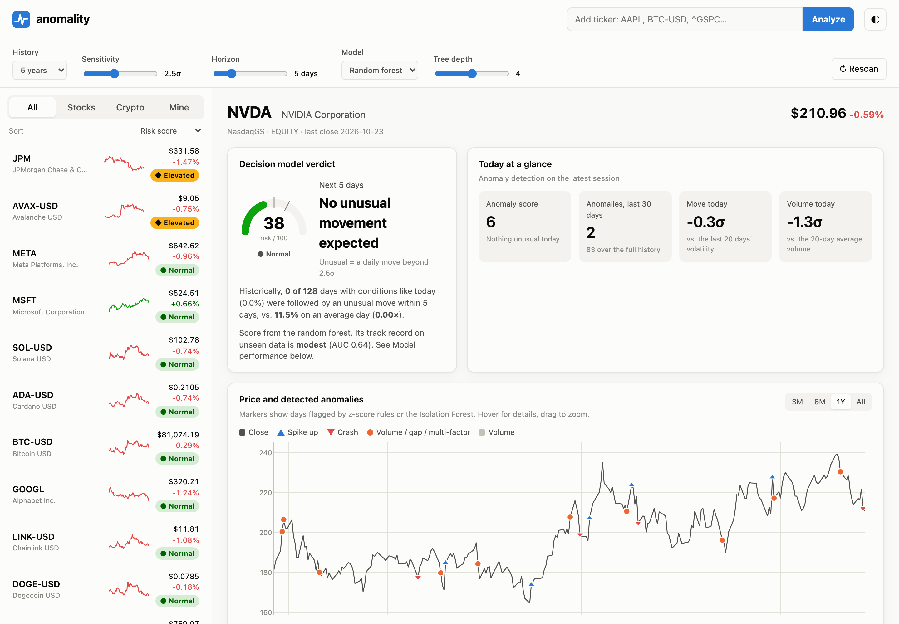
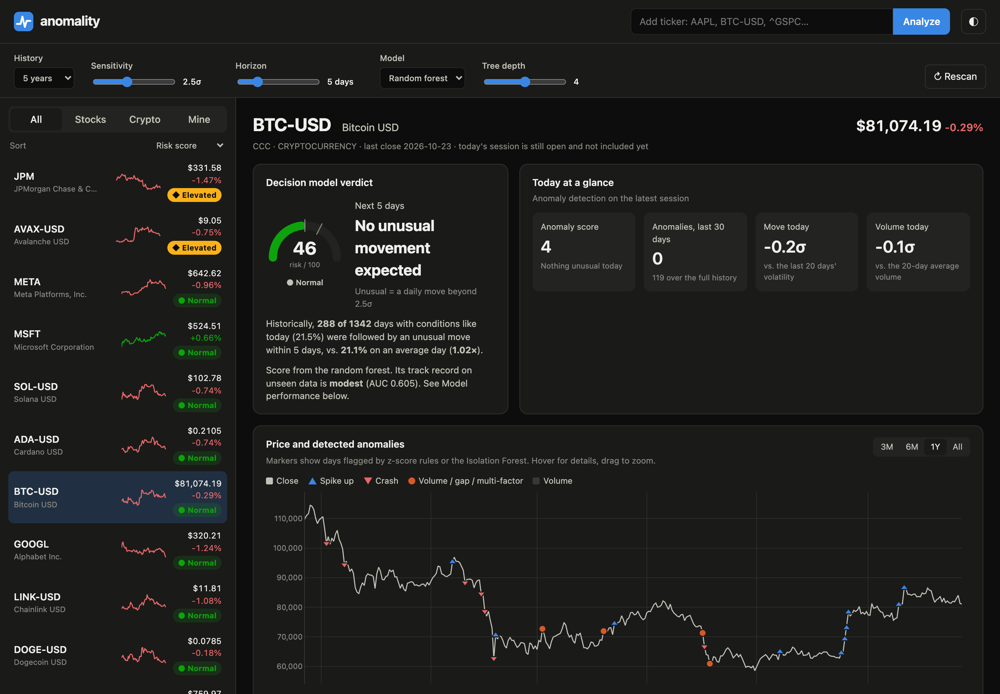
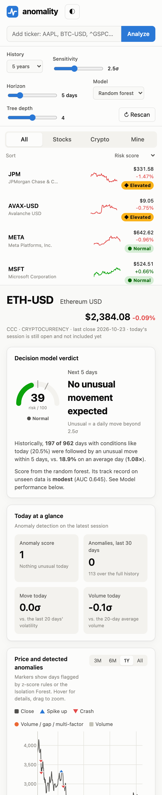

# anomality

Detects anomalies in stocks and cryptocurrencies and uses a decision model to judge
which assets are likely to make an **unusual move** in the coming days.

## Screenshots



| Dark mode | Phone |
|---|---|
|  |  |

| Today's decision path and drivers | Decision tree and anomaly log |
|---|---|
|  |  |

Full page: [docs/images/app_full_page.png](docs/images/app_full_page.png)

## How to run

### Requirements

- **Python 3.9 or newer** (`python3 --version` to check)
- An internet connection (for live market data; without one the app shows synthetic demo data)
- macOS or Linux. On Windows, use the manual steps below.

### Quick start (macOS / Linux)

```bash
git clone https://github.com/kaiji123/Anomality.git
cd Anomality
./run.sh
```

The first run creates a virtual environment in `.venv/` and installs the dependencies,
which takes about a minute. Later runs start in seconds. The app opens at
**http://localhost:8000**. Press `Ctrl+C` in the terminal to stop it.

To use a different port: `PORT=8080 ./run.sh`

### Manual setup (any OS)

```bash
python3 -m venv .venv
source .venv/bin/activate          # Windows: .venv\Scripts\activate
pip install -r requirements.txt
uvicorn backend.app:app --port 8000
```

Then open http://localhost:8000. For development, add `--reload` to restart on code changes.

### Using the app

1. The watchlist on the left fills in over a few seconds while every asset is scanned.
2. Click an asset to see its chart, anomalies and the model's verdict.
3. Add any Yahoo Finance ticker in the search box (`GME`, `BHP.AX`, `^GSPC`, `PEPE-USD`).
4. Use the sliders to change the sensitivity (σ), horizon (days), history length, model and tree depth.
   Everything recalculates.

### Troubleshooting

| Problem | Fix |
|---|---|
| `Address already in use` | Another program is using port 8000. Run `PORT=8080 ./run.sh` |
| `permission denied: ./run.sh` | `chmod +x run.sh` |
| Yellow "synthetic demo data" banner | Yahoo Finance couldn't be reached. Check your connection and click ↻ Rescan |
| `Symbol not found` | Use Yahoo's ticker format, e.g. `BTC-USD` not `BTC`, `BHP.AX` for Australian stocks |
| `NotOpenSSLWarning` on macOS | Harmless warning from the system Python; it can be ignored |

## Data

Prices come from Yahoo Finance's public chart endpoint (daily candles, no API key).
See **[docs/DATA_COLLECTION.md](docs/DATA_COLLECTION.md)** for the source, the cleaning
steps (time zones, split/dividend adjustment, unfinished sessions), the derived features
and the known limitations.

## What it does

1. **Data**: daily candles from Yahoo Finance for any ticker (`AAPL`, `SPY`, `BTC-USD`, `^GSPC`, …).
   If the network is down, it falls back to clearly labeled synthetic demo data.
2. **Anomaly detection** (`backend/analysis.py → detect`):
   - z-scores of return, volume, intraday range and opening gap vs. the previous 20 days
   - an **Isolation Forest** that catches days that are odd across several features at once
   - each day gets a 0–100 anomaly score and a type (price spike/crash, volume surge, gap, multi-factor outlier)
3. **Decision model** (`DecisionModel`):
   - 12 backward-looking indicators (volatility regime, momentum, RSI, Bollinger %B, recent shock count, …)
   - target: does a move larger than *N*σ happen within the next *H* days?
   - **random forest** (default) or single **decision tree**, trained on the first 75% of history
     and tested on the most recent 25% it never saw (AUC, precision, recall shown in the UI)
   - verdict: **High** (score ≥ 65), **Elevated** (≥ 50), **Normal**. 50 means "as likely as an average day"
   - a single tree is always fitted so every verdict comes with readable rules and today's decision path

## Trained regime model

A research-paper model, **RG-ResMoE** (Ye & Borde, arXiv:2608.12251), trained on 56 assets to
forecast next-week volatility, with a gate that adapts to the market regime. In a 30-window
walk-forward test (2019–2026, 103,593 unseen forecasts) it beats the naive forecast and a
same-size neural network (IC 0.631 vs. 0.625), and its experts switch visibly during the
COVID crash and the 2022 bear market. The full backtest trains in about 12 minutes on a laptop.


- **Our contribution, crisis-robust regime gating:** the paper's regime gate breaks in a crash;
  log-scaled volatility inputs fix it (25/30 test windows improved, p < 0.001).
  **[docs/CRISIS_ROBUST_GATING.md](docs/CRISIS_ROBUST_GATING.md)**
- Design, benchmark and findings: **[docs/REGIME_MODEL.md](docs/REGIME_MODEL.md)**
- All tables and figures: **[docs/REGIME_RESULTS.md](docs/REGIME_RESULTS.md)**

```bash
.venv/bin/python -m regime.train --quick   # 1-minute smoke test
.venv/bin/python -m regime.train           # full walk-forward training (~12 min)
.venv/bin/python -m regime.report          # regenerate figures and tables
```

Not shown in the app yet; that's the next step.

## Interface

- Watchlist scanner (stocks, crypto, your own tickers), sorted by risk
- Price chart with anomaly markers and volume; click a log row to zoom to that date
- Out-of-sample risk-score history vs. actual unusual moves
- Today's decision path, feature importance, and the full interactive decision tree
- Adjustable sensitivity (σ), horizon (days), history length, model type and tree depth
- Light and dark themes, works on phones

## API

- `GET /api/analyze/{symbol}?period=5y&threshold=2.5&horizon=5&model=forest&depth=4`
- `GET /api/scan?symbols=AAPL,BTC-USD&…`
- `GET /api/watchlist`

> Statistical research tool, not financial advice. Market moves are mostly unpredictable;
> the model mainly picks up volatility clustering, and its accuracy is shown honestly in the UI.
