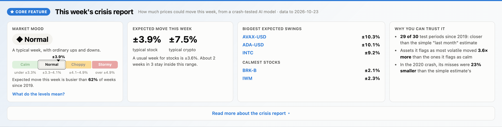
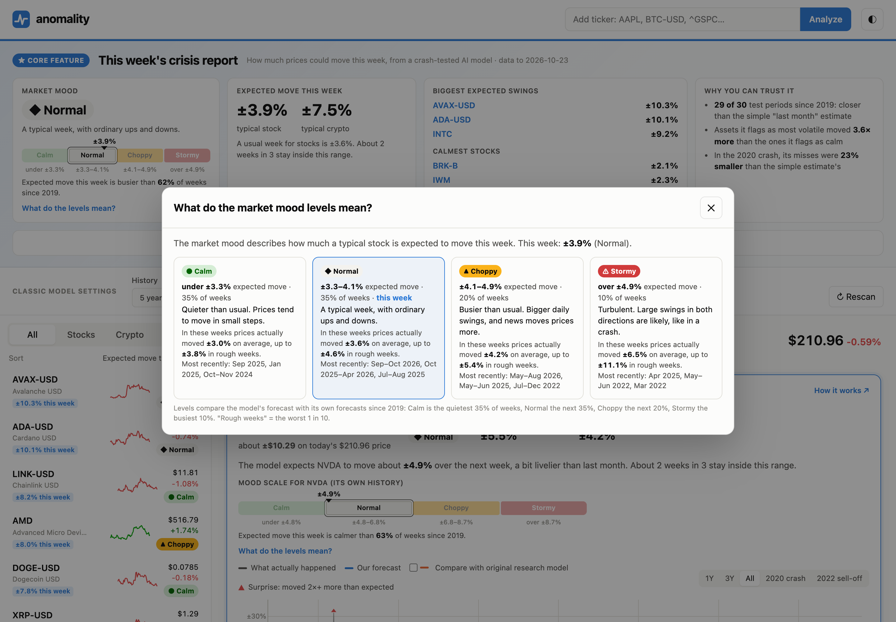
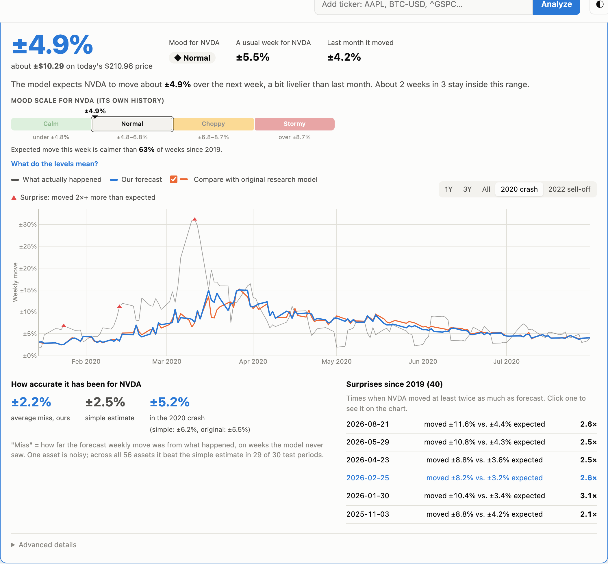
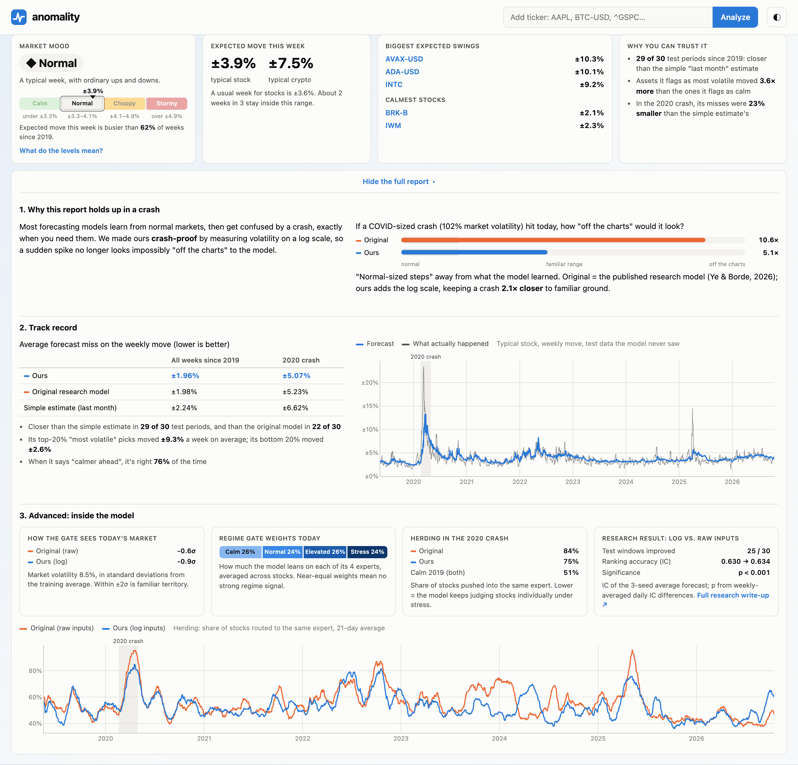
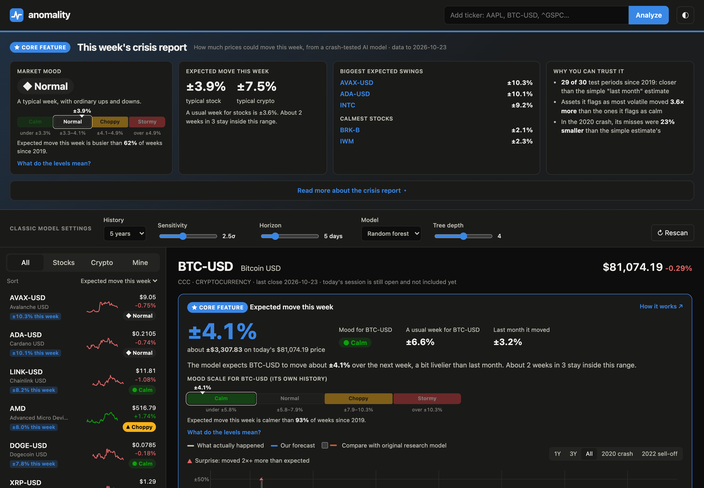
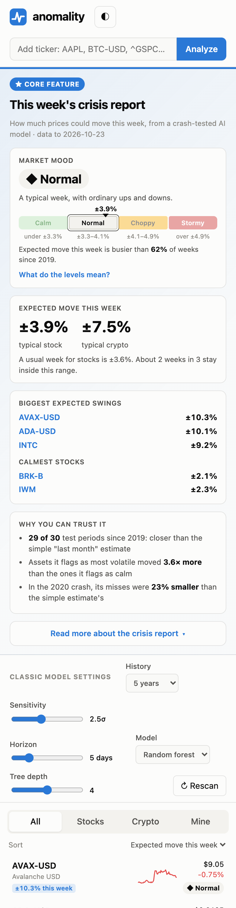
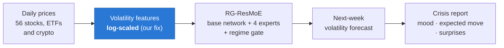
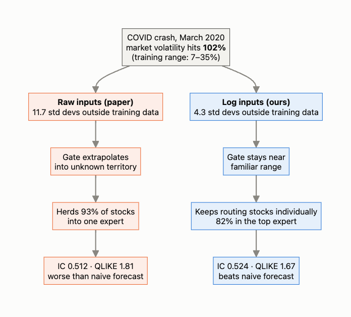
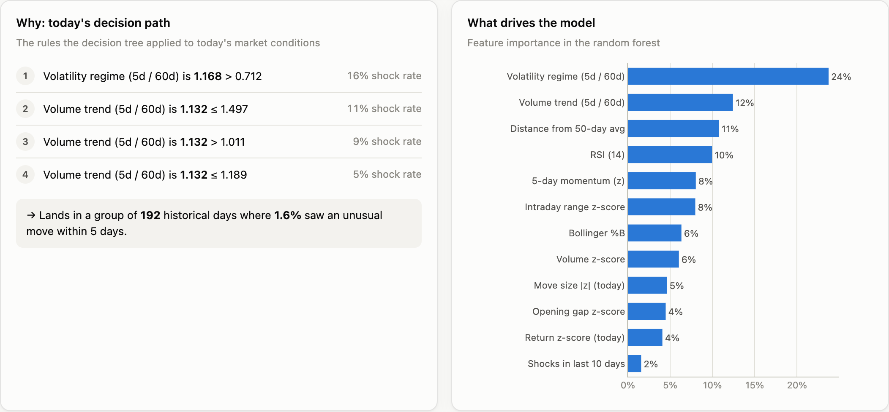
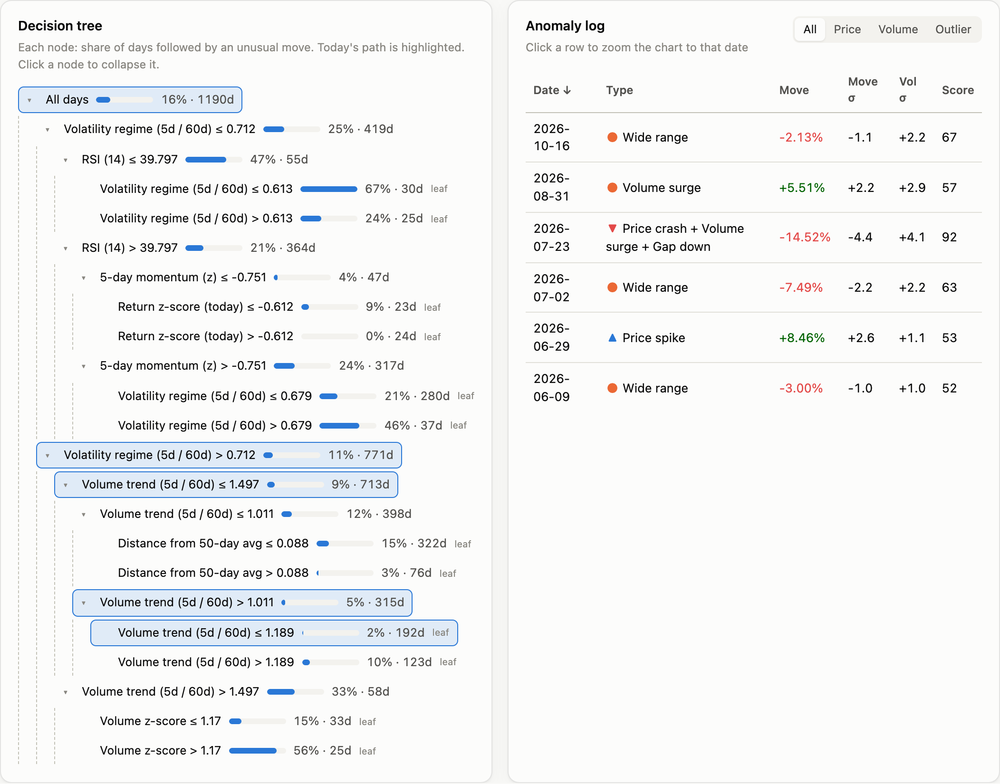

# anomality

**A weekly crisis report for stocks and crypto: how much prices could move this week, from an
AI model built to stay reliable when markets crash.**



Most forecasting models learn from normal markets and then break down in a crash, exactly
when you need them. anomality is built on a 2026 research model (RG-ResMoE) that we
**crash-proofed**: we found that its regime gate fails in a market crash, fixed it with
log-scaled volatility inputs, and tested the fix on seven years of data it never saw.

## Why it matters

| | |
|---|---|
| **±1.96%** | average miss on the weekly move, vs. ±2.24% for the simple "last month" estimate |
| **29 of 30** | test periods since 2019 where it beat the simple estimate |
| **3.6×** | how much more the assets it flags as most volatile actually moved than the ones it flags as calm |
| **23% smaller** | misses than the simple estimate during the 2020 crash |
| **25 of 30** | test periods where our crash-proofing beat the original research model (p < 0.001) |
| **12 minutes** | to retrain the whole 7-year backtest on a laptop. The model is just 3,177 weights |

All numbers are out-of-sample: the model is retrained on a rolling window and only scored on
weeks it never saw (May 2019 – Oct 2026, 56 assets, 103,593 forecasts).

## The product

### This week's crisis report

Four plain answers at the top of the app: the **market mood**, the **expected move this
week** for a typical stock and crypto, the **biggest and calmest expected swings**, and
**why you can trust it**. Every number is in everyday units: "±3.9% this week", not
"annualized volatility".

### A mood scale you can judge for yourself

The mood isn't just a label. The scale shows where this week sits between **Calm**,
**Normal**, **Choppy** and **Stormy**, with the move range for each level and how this week
compares with history ("busier than 62% of weeks since 2019"). Click **What do the levels
mean?** for a plain explanation of every level, what actually happened in those weeks, and
when the market was last there.



| Level | Share of weeks | Typical stock actually moved | Last seen |
|---|---|---|---|
| ● Calm | quietest 35% | ±3.0% | Sep 2025 |
| ◆ Normal | middle 35% | ±3.6% | this week |
| ▲ Choppy | next 20% | ±4.2% | mid-2026 |
| ⚠ Stormy | busiest 10% | ±6.5%, up to ±11% in rough weeks | Apr 2025, 2022 sell-off, 2020 crash |

### Every asset, in dollars

Open any asset to see its expected move this week, in percent and in dollars ("about
±$10.29 on today's $210.96 price"), its own mood scale, its forecast vs. what actually
happened since 2019, how accurate the model has been for it, and its **surprise weeks** (when
it moved at least twice as much as forecast). Tick **Compare with original research model**
to see the crash-proofing at work, here for NVDA in the 2020 crash:



### The full report, for the curious

**Read more about the crisis report** opens the detail: why the model holds up in a crash
(a COVID-sized shock looks 10.6× "off the charts" to the original model, 5.1× to ours), the
full track record, and the model internals (regime gate weights, crisis herding, and the
research statistics).



| Dark mode | Phone |
|---|---|
|  |  |

## How it works



1. **Data:** daily prices from Yahoo Finance, cleaned for time zones, splits, dividends and
   unfinished trading days ([docs/DATA_COLLECTION.md](docs/DATA_COLLECTION.md)).
2. **Model:** RG-ResMoE (Ye & Borde, arXiv:2608.12251). A base network forecasts next-week
   volatility; four "expert" networks add corrections; a gate decides how much to trust each
   expert based on the market regime ([docs/REGIME_MODEL.md](docs/REGIME_MODEL.md)).
3. **Our contribution, crash-proofing:** in the COVID crash, market volatility looked 11.7
   standard deviations outside the original model's training data, and its gate herded 93% of
   stocks into a single expert. Feeding volatility in on a log scale brings that crash down to
   4.3 standard deviations and keeps the gate judging stocks individually
   ([docs/CRISIS_ROBUST_GATING.md](docs/CRISIS_ROBUST_GATING.md), with diagrams and significance tests).
4. **Report:** forecasts become weekly moves (≈ 2 weeks in 3 stay inside them), moods compare
   each week with seven years of history, and surprises flag weeks that moved 2× more than expected.



## Quick start

Requires **Python 3.9+**, an internet connection, and macOS or Linux (Windows: see manual setup).

```bash
git clone https://github.com/kaiji123/Anomality.git
cd Anomality
./run.sh
```

The first run installs everything (about a minute) and opens **http://localhost:8000**. The
trained models ship in `models/`, so the crisis report works straight away. Press `Ctrl+C` to stop.
Different port: `PORT=8080 ./run.sh`.

<details>
<summary>Manual setup, retraining and troubleshooting</summary>

**Manual setup (any OS)**

```bash
python3 -m venv .venv
source .venv/bin/activate          # Windows: .venv\Scripts\activate
pip install -r requirements.txt
uvicorn backend.app:app --port 8000
```

**Retrain the model**

```bash
.venv/bin/python -m regime.train                  # recommended model, 30 windows × 3 seeds (~12 min)
.venv/bin/python -m regime.train --preset paper   # the original research model, for comparison (~17 min)
.venv/bin/python -m regime.report                 # figures and docs/REGIME_RESULTS.md
.venv/bin/python -m regime.figures_log            # crash-proofing figures
.venv/bin/python -m backend.regime_service        # refresh the compact files the app ships with
```

**Troubleshooting**

| Problem | Fix |
|---|---|
| `Address already in use` | Another program is using port 8000. Run `PORT=8080 ./run.sh` |
| `permission denied: ./run.sh` | `chmod +x run.sh` |
| Crisis report missing | Check that `models/rg_resmoe.pt`, `models/rg_resmoe_paper.pt` and `models/serving_*.csv.gz` exist, or retrain |
| Yellow "synthetic demo data" banner | Yahoo Finance couldn't be reached. Check your connection and click ↻ Rescan |
| `Symbol not found` | Use Yahoo's format, e.g. `BTC-USD` not `BTC`, `BHP.AX` for Australian stocks |
| "Not in the training universe yet" | The crisis report covers the 56 trained assets; other tickers get the classic analysis only |
| `NotOpenSSLWarning` on macOS | Harmless; ignore it |

</details>

## Also inside: classic anomaly detection

Below the crisis report, every asset also gets the original anomaly toolkit: z-score and
Isolation Forest anomaly flags on the price chart, and a random forest / decision tree that
estimates the chance of an unusual move, with its decision path and the full interactive tree.
It works for any Yahoo Finance ticker.

| Decision path and drivers | Decision tree and anomaly log |
|---|---|
|  |  |

## Documentation

| Doc | What's in it |
|---|---|
| [CRISIS_ROBUST_GATING.md](docs/CRISIS_ROBUST_GATING.md) | Our contribution: the failure, the fix, the evidence, diagrams, pitch |
| [REGIME_MODEL.md](docs/REGIME_MODEL.md) | The model, the benchmark against the authors' code, all findings |
| [REGIME_RESULTS.md](docs/REGIME_RESULTS.md) | Every metric by segment and seed (auto-generated) |
| [DATA_COLLECTION.md](docs/DATA_COLLECTION.md) | Data source, cleaning, features, limitations |

## API

| Endpoint | Returns |
|---|---|
| `GET /api/regime/market` | This week's crisis report: mood and scale, expected moves, biggest swings, track record |
| `GET /api/regime/{symbol}` | One asset: expected move, mood and scale, history, accuracy, surprises |
| `GET /api/analyze/{symbol}` | Classic anomaly detection and decision model for any ticker |
| `GET /api/scan?symbols=…` | Classic model summary for several tickers |

> anomality is a research tool, not financial advice. It forecasts how much prices may move,
> not which direction, and no model can predict the timing of a crash. Its accuracy is shown
> openly in the app.
