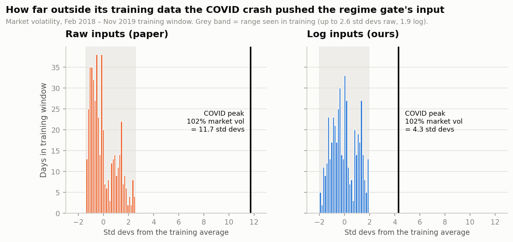
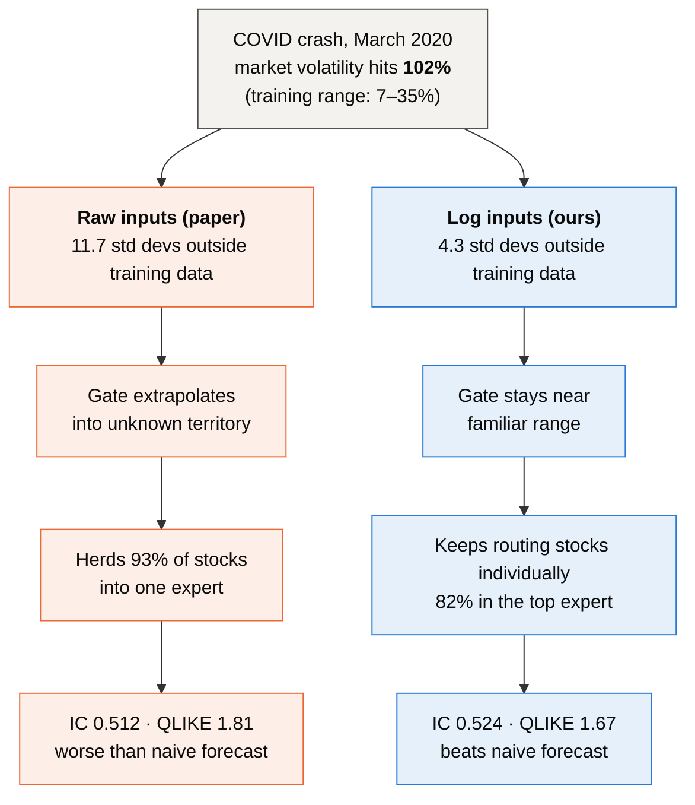
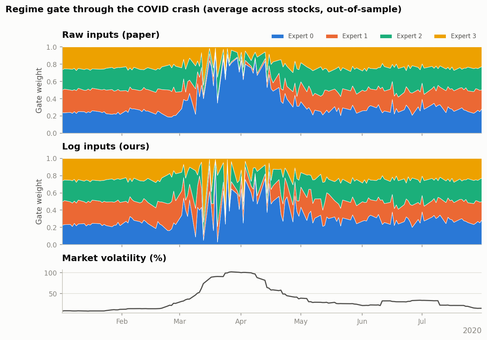
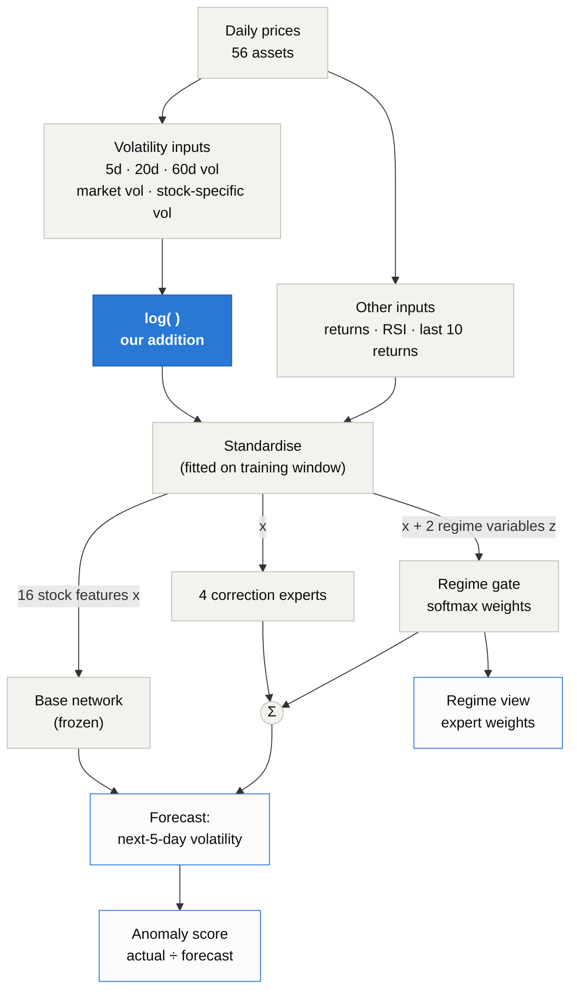
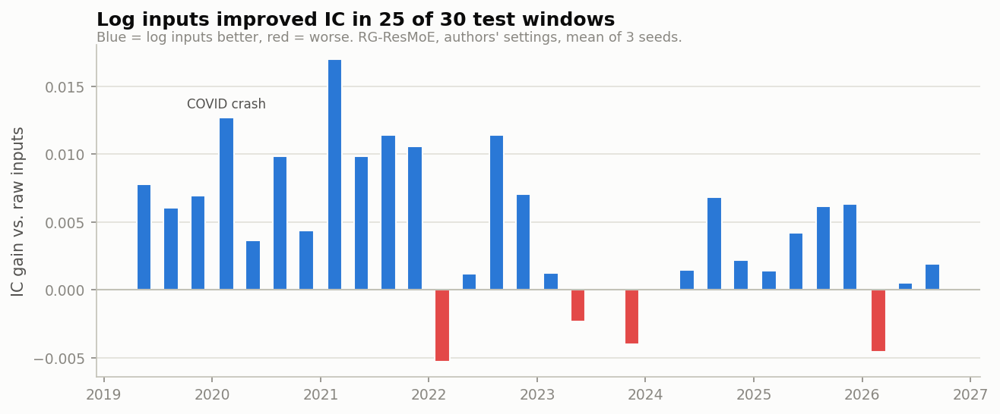
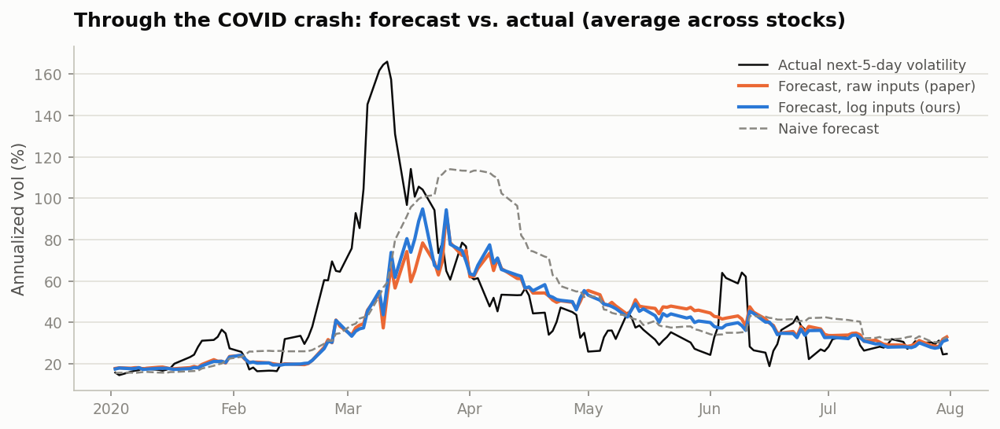
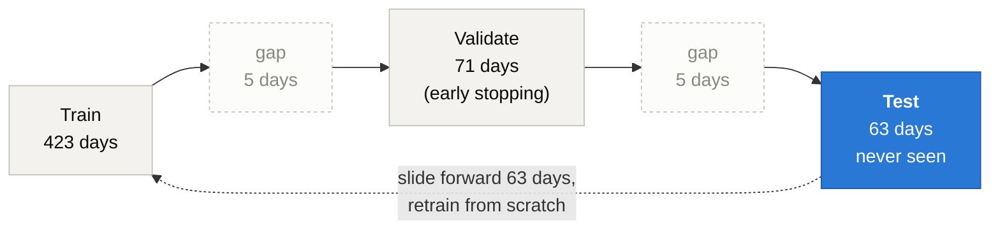

# Crisis-robust regime gating

**anomality's contribution to RG-ResMoE:** we found that the regime gate in a 2026 research
model breaks down in a market crash, diagnosed why, and fixed it with log-scaled volatility
inputs. The fix improved forecasts in 25 of 30 test windows (p < 0.001), helped most in
high-volatility markets, and runs on a model 10× smaller than our first version.

Background on the model: [REGIME_MODEL.md](REGIME_MODEL.md) · All metrics: [REGIME_RESULTS.md](REGIME_RESULTS.md)

## The pitch (30 seconds)

> Volatility models are trained on normal markets, but they matter most in crashes. We took
> RG-ResMoE, a 2026 model whose "regime gate" is meant to adapt to market conditions, and
> stress-tested it on the COVID crash. Market volatility hit 102%, which the gate saw as an input
> **11.7 standard deviations** beyond anything in its training data. The gate locked up on a
> single expert for almost every stock, and its forecasts did worse than a naive baseline. We fixed it by feeding
> volatility to the model on a log scale, which brings the same crash down to 4.3 standard
> deviations. Tested on 30 rolling windows from 2019 to 2026, the fix improved accuracy in
> **25 of 30**, across every random seed, with p < 0.001. And the whole model is 3,177 weights
> that retrain in seconds on a laptop.

## Key numbers

| | Paper's design (raw inputs) | **With our fix (log inputs)** |
|---|---|---|
| How far outside its training range the COVID peak looked to the gate | 11.7 std devs | **4.3 std devs** |
| Stocks routed to the same expert, mid-March to mid-April 2020 (calm 2019: 51%) | 93% (herded into one) | **82%** (still stock-specific) |
| Weight on each stock's top expert, same period (calm 2019: 0.29) | 0.69 | **0.63** |
| QLIKE during the COVID crash (naive baseline: 1.70) | 1.81 (worse than naive) | **1.67** (beats naive) |
| IC, all 30 test windows (2019–2026) | 0.6260 | **0.6307** |
| Test windows improved | | **25 of 30** |
| Random seeds improved | | **3 of 3** |
| Statistical significance (daily IC difference) | | **p < 0.001** |
| Model size / full backtest time | 3,177 weights / 17 min | 3,177 weights / **12 min** |

COVID figures use the forecast averaged over 3 seeds; the 30-window IC is the mean across seeds.

## 1. The problem: crashes are out of distribution

A neural network only knows the range of inputs it was trained on. RG-ResMoE's gate decides
which expert to trust based on market volatility, and before COVID the model had only seen
market volatility between about 7% and 35%. On 27 March 2020 it reached 102%.



On the raw scale the paper uses, that reading sat **11.7 standard deviations** from the
training average, more than four times beyond the most extreme day the model had ever seen
(2.6). Networks behave unpredictably that far outside their training data.



### What the gate actually did

With raw inputs, the gate herded almost every stock into the same expert for weeks: 93% of
stocks shared one dominant expert from mid-March to mid-April 2020 (vs. 51% in calm 2019), and
the average weight across stocks reached 85–95% on some days. With log inputs, 82% shared one,
so the gate kept more stock-specific routing and kept reacting as conditions changed. Each
stock's own top-expert weight rose less too (0.63 vs. 0.69). The chart shows gate weights
averaged across stocks; individual stocks vary.



## 2. The fix: log-scaled volatility inputs

Volatility moves in multiples: "volatility doubled" means the same thing whether it went from
10% to 20% or from 40% to 80%. A logarithm turns those multiples into equal steps:

| Volatility | Raw value | Log value | Step |
|---|---|---|---|
| 10% | 0.10 | −2.30 | |
| 20% | 0.20 | −1.61 | +0.69 |
| 40% | 0.40 | −0.92 | +0.69 |
| 80% | 0.80 | −0.22 | +0.69 |

On the raw scale, a crisis-sized spike is a giant outlier. On the log scale it's a few steps
up, so the model's inputs stay close to the range it learned from.

We apply it to exactly five inputs, the volatility measures: 5-, 20- and 60-day realized
volatility, market volatility and stock-specific (idiosyncratic) volatility. Two of these are
the gate's regime variables. Returns, RSI and the forecast target are unchanged, as is the
rest of the architecture. In code it's one setting, `log_vol_inputs=True`
(`regime/config.py`), applied before standardisation in `regime/train.py`.

### Step by step

For every row of data (one asset on one day), in `Scaler._inputs` (`regime/train.py`):

```python
LOG_COLS = ["rv5", "rv20", "rv60", "mkt_vol", "idio_vol"]
df[LOG_COLS] = np.log(df[LOG_COLS].clip(lower=1e-4))
```

1. **Pick the five volatility columns:** 5-, 20- and 60-day realized volatility, market
   volatility and stock-specific volatility (all annualized, so 0.20 means 20%).
2. **Clip at 0.0001** (0.01% annualized) so a value of exactly zero can't produce log(0) = −∞.
   Real volatility is essentially never this low, so the clip almost never triggers.
3. **Take the natural logarithm** (base e): 0.20 becomes ln(0.20) = −1.61.
4. **Standardise as before:** subtract the mean and divide by the standard deviation, both
   computed on the **training window only** (never on test data), so each input is centred
   around 0. The model then sees "how many standard deviations from normal" on the log scale.

**Worked example: the COVID peak** (market volatility 102% on 27 March 2020; the training
window before it averaged 15.8% and peaked at 34.6%):

| | Raw scale (paper) | Log scale (ours) |
|---|---|---|
| Value the model receives | 1.02 | ln(1.02) = 0.02 |
| Highest value seen in training | 2.6 std devs above average | 1.9 std devs |
| COVID peak | **11.7 std devs** above average | **4.3 std devs** |

On the raw scale the crash was more than 4× beyond anything the model had trained on; on the
log scale it's still extreme, but close enough to familiar territory that the gate responds
sensibly instead of extrapolating.

### What is *not* log-scaled, and why

| Input | Why it stays as it is |
|---|---|
| Daily returns (last 10 days) and 5-/20-day cumulative returns | They can be negative, and the log of a negative number is undefined. They're also already roughly symmetric around zero, so they don't have a long one-sided tail to tame |
| RSI | A bounded score between 0 and 1 with no long tail |
| The forecast target (next-5-day volatility) | Kept on the raw scale so the model's output is a normal volatility number (0.25 = 25%) and the metrics stay directly comparable with the paper |

Only volatility is always positive and prone to huge spikes, which is exactly what a
logarithm handles well.



## 3. The evidence

### Consistent across time



Log inputs improved IC in **25 of 30** rolling test windows. The biggest gains came in volatile
periods: early 2021 (+0.017), the COVID crash (+0.013) and late 2022 (+0.011). The five
windows where it wasn't better lost at most about 0.005.

### Statistically significant, and largest when markets are stressed

| Test | Result |
|---|---|
| Average daily IC gain | +0.0046 |
| Days where log inputs were better | 59% |
| t-test on daily IC differences | t = 9.7, p < 0.001 |
| Same test on weekly averages (corrects for day-to-day correlation) | t = 6.9, p < 0.001 |
| Seed 0 / 1 / 2 | 0.6260 → 0.6296 / 0.6243 → 0.6317 / 0.6278 → 0.6308 |
| High-volatility days (market vol in the top 10%, above 26%) | **+0.0060** |
| Calm days (market vol below the median) | +0.0039 |

### Better crisis forecasts, but not clairvoyant



During the crash, log inputs cut forecast error in March 2020 from 53.0 to 49.8 volatility
points (6%) and brought QLIKE below the naive baseline (1.67 vs. 1.70). **Both versions still
badly under-forecast the peak** (about 95% predicted vs. 166% actual). No model trained on calm
data could have predicted that level; the fix makes the model degrade gracefully instead of
breaking.

### A smaller model on top

| Setup | Weights | IC | QLIKE | Backtest time |
|---|---|---|---|---|
| Our first attempt (width 64) | 32,201 | 0.6269 | 0.716 | 93 min |
| Authors' settings, raw inputs | 3,177 | 0.6260 | 0.699 | 17 min |
| **Authors' settings + log inputs** | **3,177** | **0.6307** | **0.698** | **12 min** |

## 4. How we tested it

Every number above is out-of-sample: the model is retrained from scratch for each of 30
rolling windows and scored only on the 63 days that follow, which it never saw. Five-day gaps
keep the five-day forecast target from leaking across the boundaries.



- 56 assets (48 U.S. stocks and ETFs, 8 crypto pairs), May 2017 – Oct 2026
- 30 test windows, May 2019 – Oct 2026, 103,593 forecasts per model
- 3 random seeds per setup
- Same architecture, same hyperparameters (the authors' published values), same data. The
  only difference between the two runs is `log_vol_inputs`.

## 5. What we claim, and what we don't

Judges who know quantitative finance will ask about these, so here are straight answers.

| Question | Answer |
|---|---|
| Did you invent log-scaling volatility? | **No.** Log volatility is common in econometrics. Our contribution is finding that RG-ResMoE's regime gate fails without it in a crash, measuring how badly, and validating the fix rigorously. The paper uses raw inputs. |
| How big is the gain? | Modest overall (+0.0047 IC, under 1% relative), larger in stressed markets, and very consistent (25/30 windows, all seeds, p < 0.001). For comparison, the paper's headline gain over a plain network is +0.0048. |
| Is it specific to the gate? | Partly. It also helps a plain neural network (+0.003 IC), but more for RG-ResMoE (+0.0047), and it's what stops the gate from locking up in crises. |
| Does it predict crashes? | No. It forecasts volatility levels more robustly once a crisis starts. Both versions under-forecast the COVID peak. |
| Is it statistically sound? | Out-of-sample walk-forward test, purged splits, 3 seeds, significance tested on daily and weekly IC. The main limitations are 56 assets (vs. 1,027 in the paper) and 3 seeds (vs. 30). |

## 6. Reproduce

```bash
.venv/bin/python -m regime.train --preset paper        # paper's design, raw inputs (~17 min)
.venv/bin/python -m regime.train                       # with our fix (~12 min)
.venv/bin/python -m regime.report                      # metrics tables and general figures
.venv/bin/python -m regime.figures_log                 # the figures on this page
```

## Slide assets

All in `docs/images/`, rendered at 2× for slides:

| File | Use |
|---|---|
| `diagram_failure_and_fix.png` | the problem and the fix in one picture |
| `diagram_architecture.png` | where the fix sits in the model |
| `diagram_walk_forward.png` | how we tested it |
| `log_out_of_range.png` | why the gate broke (11.7 vs. 4.3 std devs) |
| `log_gate_covid.png` | the gate locking up vs. staying responsive |
| `log_window_gains.png` | 25 of 30 windows improved |
| `log_covid_forecast.png` | crisis forecasts vs. reality |

Diagram sources (Mermaid) are in `docs/diagrams/`.
