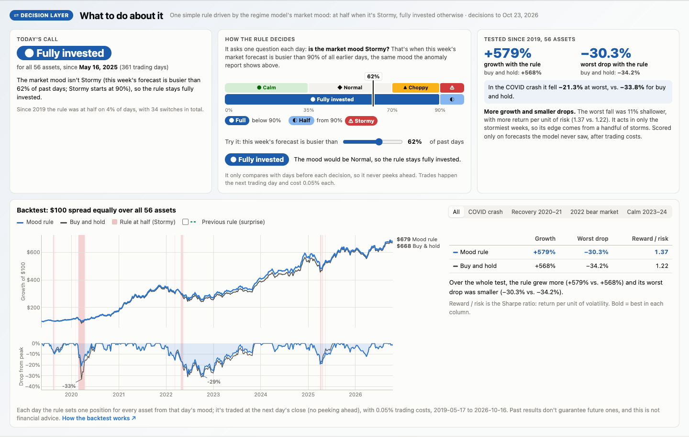

# Decision layer

The forecaster (RG-ResMoE, see [REGIME_MODEL.md](REGIME_MODEL.md)) predicts how much prices
may move. The decision layer turns that into a position for every asset (fully invested or
half) and measures whether acting on it beats buy-and-hold after costs.

In the app:

- **What to do about it**, under the anomaly report: today's call, a "try it" slider on the
  rule's storm meter, and the backtest (growth of $100 and drop from peak vs. buy-and-hold,
  with the weeks the rule was cut back shaded, zoomable to each market phase).
- **What the rule says for {asset}**, a card on every asset: today's position and the reason,
  the market mood next to the asset's own mood, time spent in each position, and the rule vs.
  buy-and-hold for that asset by phase.
- **Watchlist:** when the rule is cut back, every asset is tagged "Half".

API: `GET /api/decision/portfolio`, `GET /api/decision/{symbol}`.



## The rule: half invested when the market mood is Stormy

Each day the rule asks one question: **is the regime model's market mood Stormy?**

- **Market forecast:** the model's forecast of next week's volatility, averaged over the 48
  stocks and ETFs (crypto excluded), the same "typical stock" the anomaly report shows.
- **Storminess:** the share of all *earlier* days whose market forecast was lower. 62% means
  this week's forecast is busier than 62% of past days.
- **Stormy:** storminess of 90% or more, which is exactly where the app's Stormy mood starts
  (the busiest 10% of weeks; `MOODS` in `backend/regime_service.py`, checked by a test).

| market mood | storminess | position |
|---|---|---|
| Calm / Normal / Choppy | under 90% | fully invested |
| Stormy | 90% or more | half invested (every asset) |

No training and no tuning: the threshold is the app's existing Stormy band, and half is the
natural middle step. The rule waits until it has 60 trading days of forecast history before
it can call a storm. Settings live in `backend/decision.py` (`MoodConfig`, `COST_BPS`,
`EXEC_LAG`). Every day is logged with its reason (`stormy (93%)`, `not stormy (62%)`).

**One call for the whole market.** Every asset gets the same position. We also tested using
each asset's own mood (half when *that asset's* forecast is in its own busiest 10%): it made
+506% with a −33.0% worst drop, worse than the market version on both counts, so the app uses
the market's mood.

## Why the rule changed

The first rule (kept in the app as "Previous rule (surprise)") cut exposure when an asset's
last 20 days swung more than the model expected: half from 1.3× the forecast, cash from 2×.
It lagged buy-and-hold (+400% vs. +568%) because big surprises are usually followed by
rebounds. On the days it had just moved to cash, the assets went on to earn the equivalent
of 181% a year; after a half call, 30% a year; after a full call, 26% a year. It stepped
aside right before the best days. Scaled up to buy-and-hold's level of risk, it would have
made 556%: it reduced risk, but no better than simply holding less.

It also barely used the regime model: a storm the model saw coming raised the forecast too,
so the rule stayed invested (92% invested on average in Calm weeks, 87% in Stormy ones). The
mood rule uses the regime model directly: when the model says Stormy, it cuts back.

## The backtest

- **Forecasts:** the walk-forward test forecasts only, so every decision uses a model that
  never saw that day (103,593 forecasts, 56 assets, May 2019 – Oct 2026).
- **Storminess:** compared only with earlier days, so it can be acted on the same day.
- **Prices:** the same cleaned Yahoo Finance closes the model was trained on
  ([DATA_COLLECTION.md](DATA_COLLECTION.md)), on the U.S. trading calendar.
- **Timing:** a decision at close `t` is traded at close `t+1` and first earns day `t+2`'s
  return. The delay is applied to each asset before the portfolio is averaged.
- **Costs:** 5 bps (0.05%) per unit of exposure changed.
- **Portfolio:** equal weight across all assets each day; the uninvested half earns nothing.

## Results

### Full period (May 2019 – Oct 2026, 56 assets, 5 bps)

| system | net return | annual volatility | Sharpe | max drawdown | turnover |
|---|---|---|---|---|---|
| **mood rule** | **+579%** | 20.4% | **1.37** | −30.3% | 2.4/yr |
| buy and hold | +568% | 23.3% | 1.22 | −34.2% | 0.1/yr |
| previous rule (surprise) | +400% | 19.6% | 1.21 | −29.3% | 5.8/yr |

The rule was half invested on 4% of days, with 34 switches in seven and a half years.

### By market phase

| phase | system | net return | max drawdown |
|---|---|---|---|
| COVID crash (Feb–Apr 2020) | mood rule | **−7.8%** | **−21.3%** |
| | buy and hold | −12.2% | −33.8% |
| 2022 bear market (Jan–Oct 2022) | mood rule | **−18.4%** | **−28.4%** |
| | buy and hold | −20.8% | −30.5% |
| Recovery (May 2020 – Dec 2021) | mood rule | +204% | −11.0% |
| | buy and hold | +204% | −11.0% |
| Calm (2023–24) | mood rule | +106% | −10.9% |
| | buy and hold | +106% | −10.9% |

In calm and recovering markets the mood never turned Stormy, so the rule simply held. It
acts in storms: in the COVID crash its worst drop was about a third smaller.

**Year by year** (rule vs. buy and hold): 2019 +11.3% vs. +13.3%, 2020 +58.6% vs. +52.0%,
2021 identical, 2022 −22.9% vs. −25.2%, 2023 and 2024 identical, 2025 +9.4% vs. +13.7%,
2026 identical.

### Caveats

- **The edge comes from a handful of storms.** Most of the gain is the 2020 crash and 2022;
  it gave some back in 2019 and 2025, when it cut back and markets bounced. Two crashes are a
  small sample.
- **Growth vs. risk.** Return per unit of risk beats buy-and-hold at every setting we tried
  (below). Total growth beats it at 90% / half and at 95%, roughly ties at 90% / cash, and
  falls short when the cut kicks in earlier (80–85%).
- **Costs.** At 20 bps (four times our assumption) the rule makes +561% vs. +567%; its
  smaller drops and higher Sharpe (1.35 vs. 1.22) remain.

### Robustness

Settings (`python -m backend.sensitivity`), buy and hold for reference: +568%, −34.2%, Sharpe 1.22.

| Stormy from | cut to | net return | max drawdown | Sharpe | turnover |
|---|---|---|---|---|---|
| 80% | half | +462% | −33.5% | 1.30 | 5.0/yr |
| 80% | cash | +353% | −35.4% | 1.23 | 9.9/yr |
| 85% | half | +513% | −33.7% | 1.34 | 3.8/yr |
| 85% | cash | +441% | −35.4% | 1.33 | 7.4/yr |
| **90%** | **half** | **+579%** | **−30.3%** | **1.37** | **2.4/yr** |
| 90% | cash | +568% | −28.4% | 1.43 | 4.7/yr |
| 95% | half | +664% | −28.9% | 1.41 | 1.2/yr |
| 95% | cash | +752% | −25.3% | 1.53 | 2.3/yr |

We present 90% / half because 90% is the app's own Stormy band, not because it scored best
(95% / cash did).

Costs (`python -m backend.cost_sensitivity`): net return +585% / +579% / +573% / +561% at
0 / 5 / 10 / 20 bps; worst drop −30.1% to −30.9%; Sharpe 1.38 to 1.35.

## How we checked it

Beyond the unit tests, a review on the real data (Oct 24, 2026) confirmed:

- **No look-ahead.** Each day's return is that day's close-to-close move; storminess and the
  20-day realized volatility use only data up to the decision day; a decision on day `t`
  first earns day `t+2`'s return (checked by hand on NVDA, and by
  `test_portfolio_decision_never_earns_its_own_day` and `test_storminess_uses_only_the_past`).
- **No gaps.** All 56 assets (including the 8 crypto) have one row per U.S. trading day, so
  the two-day delay is never stretched or skipped.
- **Same mood as the app.** Today's storminess (62.1%) matches the anomaly report's market
  mood percentile exactly.
- **A fresh clone gives the same answer.** With only the files in git (the compact
  `models/serving_*.csv.gz`, rounded to 4 decimals), the mood rule, buy-and-hold and today's
  call are identical. The previous rule shows +399.7% instead of +400.4%, because a few days
  that sit exactly on its thresholds round the other way.

## Corrections to the first version

The first version of this document reported +114% for the surprise rule and +217% for
buy-and-hold, with a −66.9% buy-and-hold drawdown. Two bugs caused that, and both are fixed
and covered by tests in `tests/test_decision.py`:

1. **Exposure counted twice.** The portfolio return multiplied each asset's exposure into
   its return, then the backtest multiplied by the average exposure again, so a half-invested
   day earned a quarter. The exposure delay now happens per asset, before averaging
   (`backend/backtest.py: hold`).
2. **A separate price download.** A second price file (via `yfinance`) didn't line up with
   the forecasts: 19,488 rows, including all crypto, were dropped, and the drawdowns were
   implausible. The backtest now uses the same cleaned prices as the model, so nothing is
   dropped and no extra packages are needed.

## Limitations

- **Simulated, not live:** the backtest is the trading engine; there is no live bot.
- **Equal weight, daily rebalancing:** a simplification; real portfolios differ.
- **Cash earns nothing:** the uninvested half earns no interest, which slightly understates
  the rule.
- **Crypto on the U.S. calendar:** a Monday crypto return includes the weekend, as in the
  model's training data. Crypto follows the stock market's mood.
- **Today's position** uses the final model's forecasts for the days after the walk-forward
  forecasts end (a week or so); everything in the results above is walk-forward only.

## What this is not

Not a direction predictor. Not a learned controller. Not financial advice. It's the decision
half of a trading research platform: a rule, a backtest, and an honest result.

## Reproduce

```bash
python -m backend.run_decision          # comparison of the three systems -> results/decision.json
python -m backend.regime_slices         # four market phases
python -m backend.cost_sensitivity      # edge vs. cost (0/5/10/20 bps)
python -m backend.sensitivity           # robustness to the Stormy threshold and the cut
python -m backend.portfolio_view NVDA   # the rule's daily tape through today, plus one asset
pytest tests/test_decision.py           # 14 tests: both rules, causality, costs, no double counting
```
