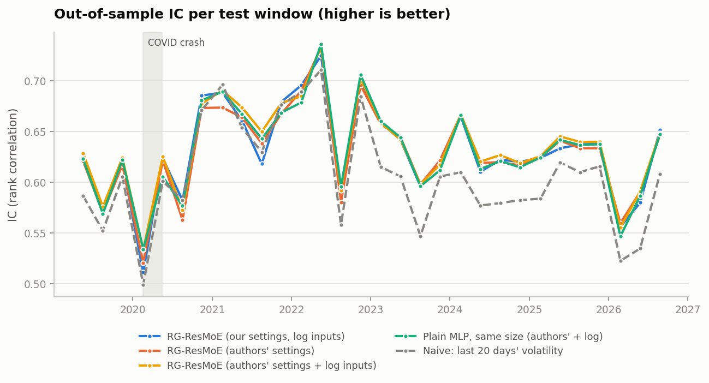
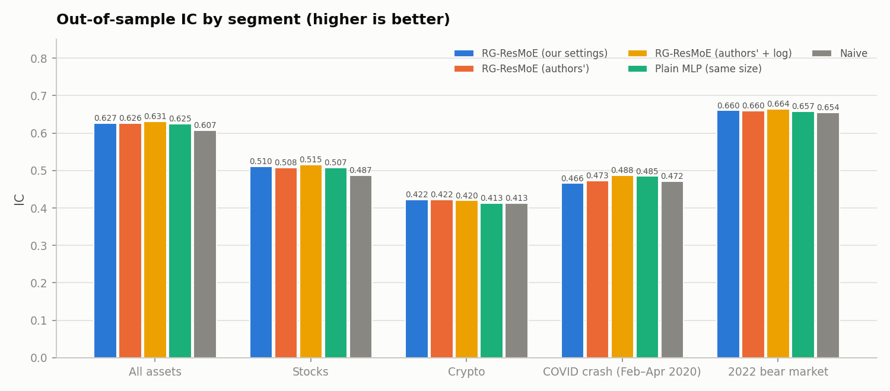
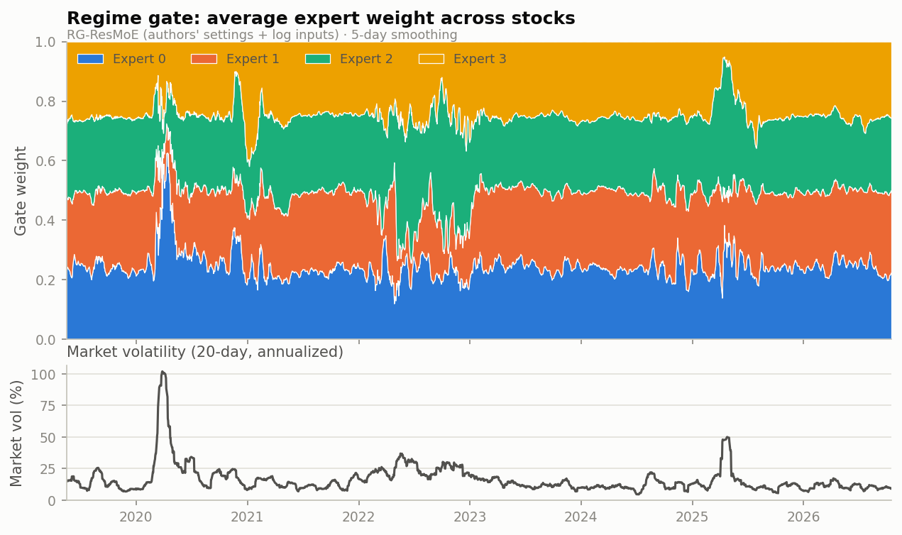
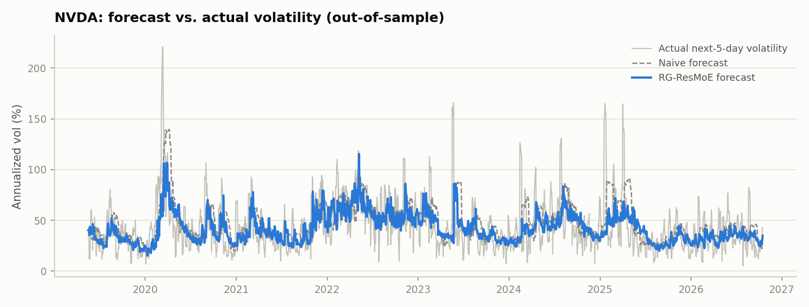
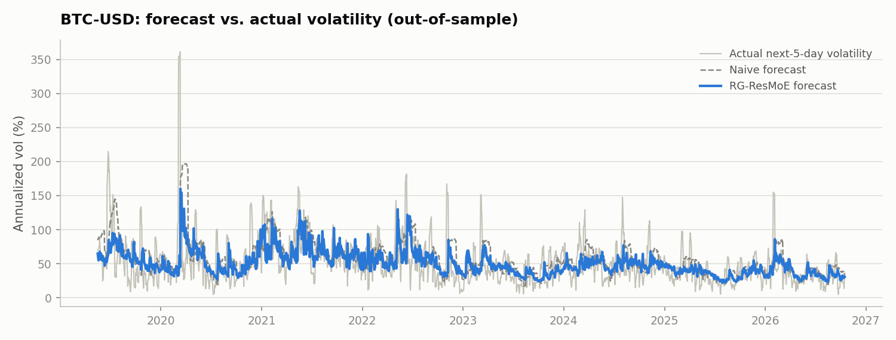

# Regime model: RG-ResMoE

Design, benchmark and results for anomality's **trained** regime and anomaly model, based
on a published architecture instead of hand-written rules.

Status: **trained and evaluated** (30 walk-forward windows, May 2019 – Oct 2026, 3 seeds).
Not wired into the app yet (see [Roadmap](#roadmap)). Full auto-generated tables:
[REGIME_RESULTS.md](REGIME_RESULTS.md).

## Summary

| | |
|---|---|
| Model | RG-ResMoE (Ye & Borde, arXiv:2608.12251), 3,177 weights |
| Data | 56 assets (48 U.S. stocks/ETFs, 8 crypto pairs), daily, May 2017 – Oct 2026 |
| Test | 30 rolling windows, 103,593 forecasts the model never saw during training |
| Training time | **12 minutes** for the full backtest (3 seeds) on an M4 MacBook Air CPU |
| Result | Beats the naive forecast on every metric, and beats a same-size plain neural network (IC 0.631 vs. 0.625), which is the paper's main claim. Ties its own base network |
| Regimes | 4 experts that split along market volatility; they visibly switch during the COVID crash, the 2022 bear market and the April 2025 volatility spike |
| Recommended settings | the authors' published settings **plus log-scaled volatility inputs** (our addition) |

## Why

anomality originally flagged anomalies with fixed statistical rules (rolling z-scores) and an
Isolation Forest fitted per asset on the fly. Nothing was learned across assets, and nothing
"knew" what market regime we are in. We wanted a model that:

1. **learns from data** across many assets, not just rules,
2. **adapts to the market regime** (calm vs. stressed), and lets us show that regime in the UI,
3. gives a **trained anomaly score**, and
4. can be **evaluated honestly** against simpler baselines.

## The paper

> Junyi Ye and Gargi Vijay Borde, *Regime-Gated Residual Mixture-of-Experts for
> Cross-Sectional Volatility Forecasting*, arXiv:2608.12251 (August 2026), ICAIF '26.
> Paper: <https://arxiv.org/abs/2608.12251> · Code: <https://github.com/JunyiYe/rg-resmoe> (MIT)

**Question it answers:** where should regime information enter a neural volatility forecaster?

**Answer:** not as an extra input. Use it only to **route** small correction networks
("experts") that adjust a base forecast. Feeding regime variables straight into the
forecaster made it worse and less stable; routing them through a gate made it better.

### Architecture

```
            stock features x (16)                        regime variables z (2)
                    │                                             │
      ┌─────────────┼───────────────────────┐                     │
      ▼             ▼                       ▼                     ▼
 Base network   Expert 1 … Expert K     Gate g(x, z) ──► softmax ──► weights π₁ … π_K
  (frozen)      (corrections r_k)                                  │
      │             └───────── Σ π_k · r_k(x) ◄───────────────────┘
      ▼                         │
   ŷ_base   ─────────(+)────────┘──►  ŷ = forecast of next-5-day volatility
```

- **Block** (base and experts): 2 hidden layers of width H, GELU activations, dropout 0.1.
- **Base network** `ŷ_base = Block(x)`: trained first, then frozen.
- **K = 4 correction experts** `r_k(x) = Block(x)`: final layer initialised to zero, so the
  model starts out equal to the base forecast.
- **Gate** `π = softmax(g(x, z))`: the only part that sees the regime variables `z`.
- **Output** `ŷ = ŷ_base + Σ_k π_k · r_k(x)`.

### Inputs and target

| | Definition |
|---|---|
| Stock features **x** (16) | realized volatility over 5, 20 and 60 days; cumulative return over 5 and 20 days; RSI(14); the last 10 daily log returns |
| Regime variables **z** (2) | **market volatility**: 20-day volatility of the equal-weighted market return. **Idiosyncratic volatility**: 20-day volatility of `r_i − β_i · r_m`, with β estimated over the previous 120 days |
| Target **y** | annualized realized volatility over the next 5 days: `√252 · std(r_{t+1}, …, r_{t+5})` |

### Training

- **Stage 1:** train the base network on MSE.
- **Stage 2:** freeze the base; train experts and gate jointly on

  `L = MSE(ŷ, y) + α · mean[(Σ_k π_k r_k)²] + λ_LB · Σ_k (π̄_k − 1/K)²`

  The middle term keeps corrections small; the last term stops the gate from always picking
  the same expert (π̄_k is the average weight of expert k over the batch).
- Full-batch Adam, early stopping on a validation split, best checkpoint restored.
- **Walk-forward evaluation:** 504-day development window (first 85% train, last 15%
  validation), then a 63-day test window; slide forward 63 days and retrain. This is
  periodic retraining on a rolling window, not online (continuous) learning.

### Paper's results (U.S. panel, 1,027 stocks, Apr 2018 – Oct 2025, 30 seeds)

From the repo's `results/reference/final_metrics.txt`:

| Model | IC | RMSE | R² | QLIKE |
|---|---|---|---|---|
| **RG-ResMoE** | **0.5469 ± 0.0012** | **0.2304** | **0.292** | **0.74** |
| Plain MLP, same size (MLP-L) | 0.5421 ± 0.0033 | 0.2320 | 0.283 | 2.23 ± 5.15 |
| Small MLP (MLP-S) | 0.5393 ± 0.0034 | 0.2323 | 0.280 | 74.26 ± 395 |
| Standard mixture-of-experts | 0.5413 ± 0.0027 | 0.2357 | 0.259 | 8,775 |
| HAR | 0.5315 | 0.2347 | 0.266 | 0.75 |
| Ridge | 0.5266 | 0.2336 | 0.273 | 0.76 |
| GARCH(1,1) | 0.5200 | 0.2642 | 0.070 | 1.12 |
| Persistence | 0.5018 | 0.2570 | 0.121 | 0.80 |

The overall accuracy gain is small. The main wins are **training stability** and
**crisis performance**: during the COVID window the IC advantage over the plain MLP was
+0.032, vs. +0.005 over the full sample. Soft routing beat hard (top-1) routing.

## Benchmark against the authors' repository

**No pretrained model is published.** The repo ships code, the paper's 1,029-ticker price
data, and summary metrics only (no weights, no per-stock forecasts). So "using the authors'
model" means training it ourselves either way. What the repo gave us:

1. **The real hyperparameters**, which the paper's public text leaves out. They differed a lot from our first guesses:

   | Setting | Authors' code | Our first guess |
   |---|---|---|
   | Width H (base and experts) | **16** | 64 |
   | Gate | 1 hidden layer of 16, no dropout | 2 layers of 64 + dropout |
   | Learning rate | **0.03** base, **0.01** experts | 0.003 |
   | α (shrink corrections) | **1.0** | 0.05 |
   | λ_LB (balance experts) | **0.5** | 0.1 |
   | Early stopping | validate every 5 epochs, stop after 10 checks without improvement, max 2,000 | stop after 150 epochs without improvement, max 3,000 |
   | Target | raw volatility | standardised |
   | Plain-MLP baseline width | 44 | size-matched (170) |

2. **Feasibility of the full 1,027-stock universe on a laptop.** We ran the authors' own
   training script on their data on the M4 MacBook Air CPU: **about 2 minutes per window**
   (≈1 hour per seed for all 30 windows). We stopped it after 2 windows because our own
   pipeline with their settings answers the more relevant question (does it work on
   *our* assets), and a full reproduction would have taken ~2 hours of CPU.
3. **A difference in protocol.** The authors' split has no gap between training and test, so the
   last few training targets overlap the first test days. Our pipeline keeps a 5-day purge,
   which is slightly stricter.

## How anomality adapts it

| Topic | Paper | anomality |
|---|---|---|
| Universe | 1,027 U.S. stocks | 48 large U.S. stocks and ETFs, plus 8 crypto pairs |
| Calendar | U.S. trading days | U.S. trading days. Crypto prices are sampled on those days, so a Monday crypto return includes the weekend |
| Market return | equal-weighted universe | equal-weighted return of the **stocks** in the panel (crypto excluded so it doesn't dominate) |
| Hyperparameters | see table above | **authors' values** (recommended preset) |
| Volatility inputs | raw | **log-transformed** before scaling (rv5, rv20, rv60, market vol, idiosyncratic vol). See [Findings](#findings) |
| Forecast floor | none | forecasts below **3% annualized** are clamped. See [Findings](#findings) |
| Gap between splits | none | 5-day **purge** between train/validation and validation/test |
| Random seeds | 30 | 3 |
| Retraining | every 63 days in the backtest | same in the backtest. Live, retrain daily or weekly on the latest 504 days (one fit takes seconds) |

### From volatility forecast to anomaly and regime

The paper forecasts volatility. anomality turns that into three things for the UI:

- **Trained anomaly score**: how far realized volatility comes in above the model's
  forecast, `surprise = realized_vol / forecast_vol`. A large surprise is something the model
  did *not* expect, which is a more meaningful anomaly than "big move vs. the last 20 days".
- **Forecast risk**: the forecast itself, relative to the asset's own history: an early
  warning that unusual moves are likely.
- **Regime view**: the gate weights π₁ … π₄ for each day (see the gate timeline below).

## Evaluation

Every model is scored only on test windows it never saw during training, using the paper's metrics:

- **IC**: Spearman rank correlation between forecast and actual volatility across assets,
  per day, averaged. Higher means better at ranking which assets will be most volatile.
- **RMSE** and **R²** on annualized volatility.
- **QLIKE** = `y²/ŷ² − ln(y²/ŷ²) − 1`: the standard volatility-forecast loss, which
  punishes under-forecasting volatility heavily. Lower is better.

Baselines: **naive** (last 20 days' realized volatility), a **plain MLP** of about the same
size (the paper's main baseline), and RG-ResMoE's own **base network** without the experts.

## Findings

### 1. Settings compared (all 30 windows, 3 seeds)

| Run | Weights | IC ↑ | RMSE ↓ | QLIKE ↓ | IC, COVID crash ↑ | Backtest time |
|---|---|---|---|---|---|---|
| Our first settings (width 64, log inputs) | 32,201 | 0.6269 ± 0.0008 | 0.2601 | 0.716 | 0.466 | 93 min |
| Authors' settings | 3,177 | 0.6260 ± 0.0014 | 0.2590 | 0.699 | 0.473 | 17 min |
| **Authors' settings + log inputs (recommended)** | **3,177** | **0.6307 ± 0.0009** | **0.2580** | **0.698** | **0.488** | **12 min** |

The recommended setup is 10× smaller and 8× faster to train than our first attempt, and
better on every metric.



### 2. Recommended model vs. baselines

| Model | IC ↑ | RMSE ↓ | R² ↑ | QLIKE ↓ |
|---|---|---|---|---|
| **RG-ResMoE** | **0.6307 ± 0.0009** | **0.2580** | **0.416** | **0.698** |
| Base network only | 0.6290 ± 0.0014 | 0.2584 | 0.415 | 0.698 |
| Plain MLP (same size) | 0.6249 ± 0.0020 | 0.2595 | 0.410 | 0.731 |
| Naive (last 20 days' vol) | 0.6072 | 0.2816 | 0.304 | 0.738 |

- **Beats the plain MLP by +0.0058 IC**, close to the paper's +0.0048, and with clearly better
  QLIKE (0.698 vs. 0.731). This reproduces the paper's main claim on a different universe.
- **Ties its own base network.** On 56 assets, most of the gain over the plain MLP comes from
  the training recipe (frozen base, zero-initialised experts), not from regime-specific
  corrections. The paper's ablation found the same: routing regime variables through the gate
  added only +0.0004 IC.
- **Never failed to train** (0 of 3 seeds collapsed).



### 3. Segments and crises

| Segment | RG-ResMoE IC | Plain MLP IC | Naive IC | Notes |
|---|---|---|---|---|
| Stocks | **0.515** | 0.507 | 0.487 | clear gain over both |
| Crypto | 0.420 | 0.413 | 0.413 | small gain in IC, but naive has better QLIKE (0.88 vs. 1.00) |
| COVID crash (Feb–Apr 2020) | 0.488 | 0.485 | 0.472 | base network alone was best (0.504); naive has better QLIKE (1.70 vs. 2.01) |
| 2022 bear market | **0.664** | 0.657 | 0.654 | |

Crypto and the COVID crash are where the model is weakest. Crypto has only 8 assets and much
higher, jumpier volatility; the COVID crash was far outside anything in its training window.

### 4. The regime gate learns a calm-vs-stress axis



| Expert | Dominant on | Market vol when dominant | Realized vol when dominant | Suggested label |
|---|---|---|---|---|
| 0 | 22% of stock-days | **20.1%** | **31.1%** | stress |
| 1 | 32% of stock-days | **13.1%** | **22.0%** | calm |
| 2 | 28% of stock-days | 17.8% | 29.3% | elevated / drawdown |
| 3 | 19% of stock-days | 15.4% | 28.3% | stock-specific (high idiosyncratic vol) |

Expert 0 surges during the COVID crash (March 2020); expert 2 takes over through the 2022 bear
market and the April 2025 spike. With our first settings, one expert dominated 79% of the
time, so the gate wasn't separating regimes; the authors' settings (strong load balancing,
λ_LB = 0.5) fixed that. Labels are our interpretation from these averages.

### 5. Log-scaled volatility inputs help in crises

Full write-up with diagrams, significance tests and slide assets:
**[CRISIS_ROBUST_GATING.md](CRISIS_ROBUST_GATING.md)**.

With raw inputs, market volatility in March 2020 was ~6× its training-period average, so the
gate extrapolated badly. On the COVID test window with our first settings:

| Setting | IC: RG-ResMoE | IC: base alone | QLIKE: RG-ResMoE |
|---|---|---|---|
| Raw volatility inputs | 0.445 | 0.490 | 4.31 |
| **Log volatility inputs** | **0.506** | **0.516** | **1.74** |

Across all 30 windows with the authors' settings, log inputs raised IC from 0.6260 to 0.6307
and COVID-window IC from 0.473 to 0.488. Calm windows were unaffected.

### 6. Impossible forecasts and the 3% floor

About 40 of 103,593 forecasts came out near zero or negative (the network outputs volatility
directly). QLIKE divides by the forecast, so a handful of these pushed average QLIKE from
~0.72 to 3.6–8.6. The paper's own baselines show the same failure (MLP-S QLIKE 74 ± 395).
Forecasts are now clamped at **3% annualized** (real 5-day volatility was below that on only
0.1% of days). The floor barely changes IC and makes QLIKE meaningful; REGIME_RESULTS.md shows
QLIKE with and without it.

### 7. Example forecasts





The model tracks the level of volatility and reacts faster than the naive 20-day average
after a spike, but like any volatility model it can't predict the timing of individual
shock days.

## Code layout

| File | Purpose |
|---|---|
| `regime/config.py` | universe, window sizes, hyperparameters, `paper_config()` preset |
| `regime/dataset.py` | downloads prices, builds the panel of x, z, y |
| `regime/model.py` | Block, RG-ResMoE, plain-MLP baseline |
| `regime/train.py` | two-stage training, walk-forward evaluation, saving the final model |
| `regime/metrics.py` | IC, RMSE, R², QLIKE |
| `regime/report.py` | figures in `docs/images/` and tables in `docs/REGIME_RESULTS.md` |

Run:

```bash
.venv/bin/python -m regime.train --quick          # smoke test: last 4 windows, 1 seed (~1 min)
.venv/bin/python -m regime.train                  # recommended preset, 30 windows × 3 seeds (~12 min)
.venv/bin/python -m regime.train --preset paper   # authors' exact settings (~17 min)
.venv/bin/python -m regime.train --preset ours    # our first settings (~90 min)
.venv/bin/python -m regime.report                 # regenerate figures and REGIME_RESULTS.md
```

Outputs in `models/`: `rg_resmoe_<preset>.pt`, `walkforward_results_<preset>.json`, and
`walkforward_predictions_<preset>.csv` (not committed, 1–17 MB; regenerate by training).
`models/rg_resmoe.pt` is the recommended model, trained on the latest 504 days
(Oct 2024 – Oct 2026), which the app will load.

## Roadmap

1. ✅ Document the approach
2. ✅ Training pipeline + walk-forward evaluation vs. naive and plain-MLP baselines
3. ✅ Full walk-forward runs, benchmark against the authors' settings, results and figures
4. ☐ Serve the trained model from the API: forecast, surprise score, gate weights per asset
5. ☐ UI: regime timeline (gate weights), trained anomaly score next to the existing rules
6. ☐ Scheduled retraining (daily or weekly) on the latest 504 days
7. ☐ Larger universe: the authors' 1,027-ticker list with fresh data (≈2 min per window on the
   laptop). The paper's central argument is that the gate needs a broad cross-section
8. ☐ Optional: GRSTU (Antulov-Fantulin, Cauderan & Kolm, 2024) for discrete regime labels,
   if the full paper becomes available

## Limitations

- **Small universe.** 56 assets vs. 1,027 stocks in the paper, so the gate has less to learn
  from; RG-ResMoE only ties its own base network here.
- **Weak spots.** On crypto and during the COVID crash, the naive forecast has better QLIKE
  than any trained model.
- **3 seeds, not 30.** Differences smaller than ~0.002 IC are within noise.
- **Recent preprint.** Likely not peer-reviewed yet.
- **Volatility, not direction.** The model predicts how much prices will move, not which way.
